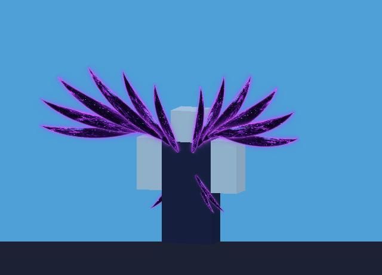

# SDCO

## Void Wings (Mythic · exclusive)

Category `Wings`, rarity Mythic. Not sold, not tradeable; granted to `merreystantach2`
(`ReplicatedStorage.Cosmetics.Items`, `GrantedTo` / `GrantedUserIds`). Granted wings are worn
by default; the owner gets a **COSMETICS** button with a live ViewportFrame preview and Equip/Unequip.



### Install

1. Paste all of [`install/InstallVoidWings.lua`](install/InstallVoidWings.lua) into Studio's command bar
   and press Enter (one undo step). It creates `ReplicatedStorage.Cosmetics`, `CosmeticsRemote`,
   `ServerScriptService.CosmeticsServer` and `StarterPlayerScripts.CosmeticsClient`.
2. Upload `assets/voidwings/*.png` (Asset Manager > Bulk Import, or
   `ROBLOX_API_KEY=... python3 tools/voidwings/upload.py --user <id>`) and paste the image ids into
   `ReplicatedStorage.Cosmetics.VoidWings.VoidWingsAssets`. Until then the wings draw as neon
   blades in the same layout. Re-running the installer keeps ids already pasted.
3. Enable Studio API access to DataStores if you want equip choices saved in Studio.

If the galaxy loop stutters in game, set `FrameFlipU` / `FrameFlipV` in `VoidWingsAssets`
(it means the atlas is being tiled from another corner).

### How it's built

- `tools/voidwings/layout.py`: the one source of geometry/motion (feather shape, wing arc, fan
  angles, sweep/tilt, beat 0.45 Hz ±12°, flutter ripple, breathing).
- `tools/voidwings/render.py`: numpy renderer. Tileable FFT noise → fbm → domain warp → colour
  ramp in each feather's own (along, across) coordinates; Bézier centreline + width profile;
  SDF rim light and halo; stars and 4-point sparkles riding the flow. 16-frame seamless loop as
  4 atlases (1024², 2×2 cells) per wing: `feather_R_*` and `feather_L_*` (every cell mirrored),
  plus `sparkle`/`mote`/`wisp` particle sprites.
- `ReplicatedStorage.Cosmetics.VoidWings`: the rig. Each feather is an invisible Part with the
  atlas as a `Texture` on its Back and Front faces; `StudsPerTile`/`OffsetStuds` pick the frame
  (14 fps). The right wing's Back face uses the right atlas and its Front face the mirrored one
  (reverse on the left), so the wings are true mirror images from every side. In play: welded
  to the torso client-side, with void-dust/sparkle/wisp ParticleEmitters and a purple
  PointLight; in a ViewportFrame: anchored, no effects.

```sh
python3 tools/voidwings/render.py     # textures -> assets/voidwings/
python3 tools/voidwings/build.py      # VoidWingsData.luau + install/InstallVoidWings.lua
python3 tools/voidwings/preview.py    # rig previews -> previews/
LUAU=luau python3 tools/voidwings/test.py  # Luau rig == Python reference, mirroring, installer
```
